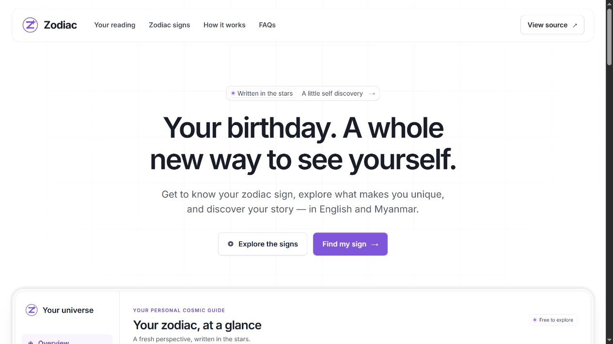
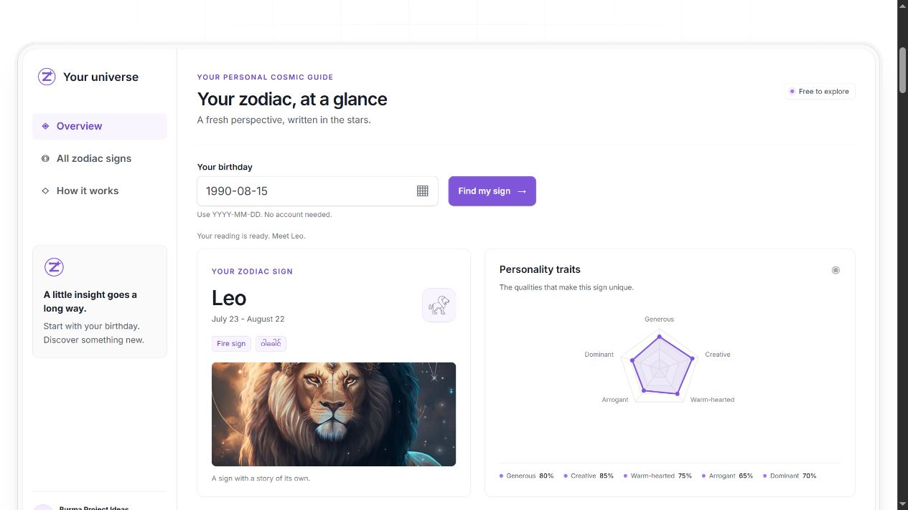
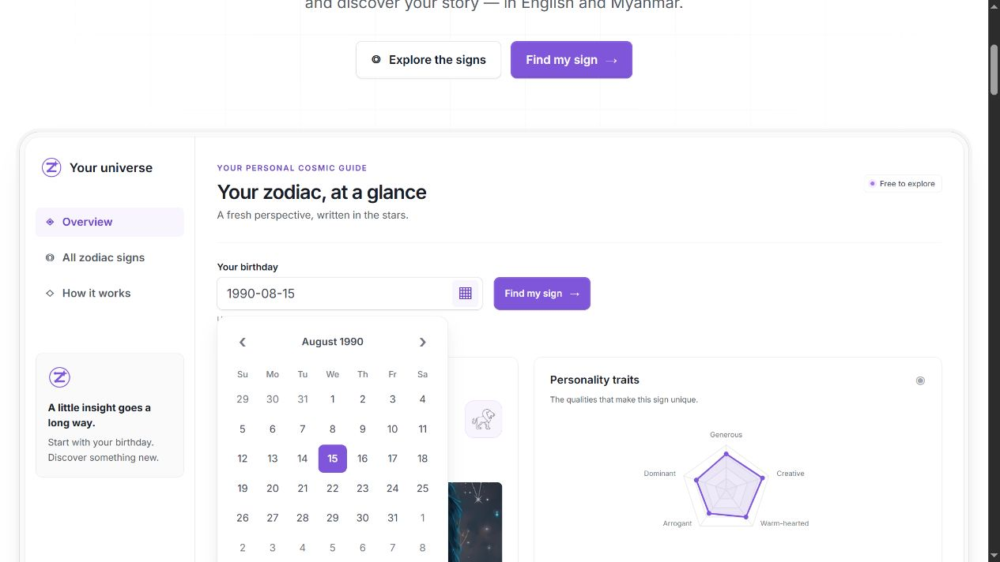
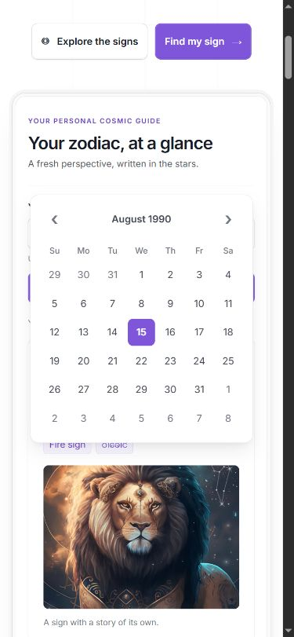
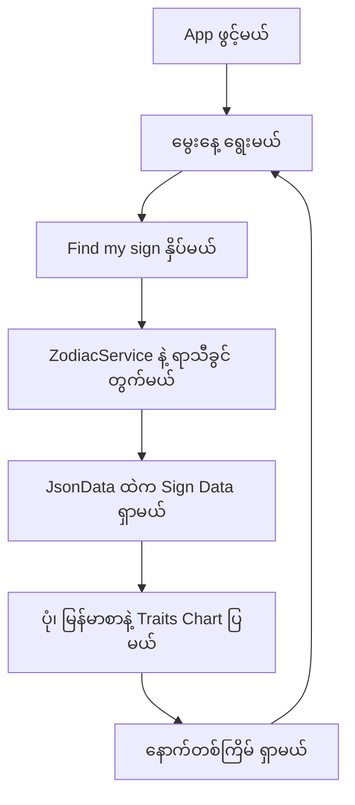
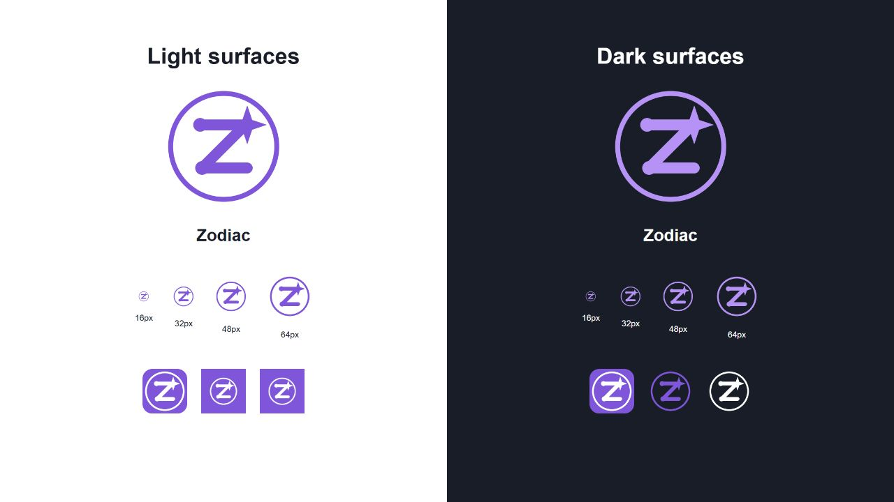

<p align="center"></p>

# Zodiac (ရာသီခွင်)

မွေးနေ့ကို ရွေးချယ်ပြီး မိမိရဲ့ ရာသီခွင်၊ မြန်မာလ၊ ကိုယ်စားပြုဒြပ်၊ Personality Traits နဲ့ သက်ဆိုင်ရာ မြန်မာဘာသာအကြောင်းအရာတွေကို ကြည့်နိုင်တဲ့ **Blazor WebAssembly Project** ပါ။ [App ကို ဒီမှာ ဖွင့်နိုင်ပါတယ်](https://blazor-zodiac.vercel.app/)။

[Burma Project Ideas](https://github.com/burma-project-ideas) အောက်မှာ နောက်လာမယ့်သူတွေ လေ့လာနိုင်ဖို့၊ ကိုယ်နှစ်သက်တဲ့ Programming Language နဲ့ ပြန်ရေးကြည့်နိုင်ဖို့ ထားပေးထားတာပါ။ App က Browser ထဲမှာ အလုပ်လုပ်ပြီး Account၊ Backend Server နဲ့ Database မလိုပါဘူး။

## Design Preview

လက်ရှိ Live App ရဲ့ Desktop Design၊ Reading Panel နဲ့ App Theme ကို သုံးထားတဲ့ Datepicker ကို အောက်မှာ ကြည့်နိုင်ပါတယ်။ Reading နမူနာမှာ `1990-08-15` ကို သုံးထားပြီး **Leo** ရလဒ်ကို ပြထားပါတယ်။

### Landing page



### Zodiac reading



### Themed datepicker

Fengyuan Chen Datepicker ကို App ရဲ့ Purple Color၊ Inter Font၊ Rounded Panel နဲ့ Selected Date / Focus Styles တွေနဲ့ ချိန်ညှိထားပါတယ်။ ရက်စွဲကို `YYYY-MM-DD` ပုံစံနဲ့ ကိုယ်တိုင်ရိုက်ထည့်နိုင်သလို Calendar ကနေလည်း ရွေးနိုင်ပါတယ်။



<details>
<summary>Mobile datepicker preview</summary>

Mobile မှာ Calendar ကို Screen အလယ်မှာ ပြထားပြီး ရက်အားလုံးကို Viewport အတွင်းမှာ ရွေးနိုင်အောင် စီစဉ်ထားပါတယ်။

<p align="center"></p>

</details>

## အဓိက ပံ့ပိုးသူများနှင့် မူရင်း Data

| ပံ့ပိုးသူ / ရင်းမြစ် | ပံ့ပိုးထားသည့်အပိုင်း |
| --- | --- |
| [Sann Lynn Htun (@sannlynnhtun-coding)](https://github.com/sannlynnhtun-coding) | မူရင်း [BlazorWasm.Zodiac](https://github.com/sannlynnhtun-coding/BlazorWasm.Zodiac) Web App |
| [Burma Project Ideas — Zodiac](https://github.com/burma-project-ideas/zodiac) | ရာသီခွင်အကြောင်းအရာ၊ မြန်မာစာသား၊ Traits နဲ့ Image Dataset |
| [Untitled UI — Landing page 01](https://www.untitledui.com/react/marketing/landing-pages/landing-page-01) | လက်ရှိ Blazor UI ရဲ့ Layout၊ Typography နဲ့ Visual Design Reference |
| [Astrology HTML Template](https://kamleshyadav.com/html/astrology/version-3/index.html) | မူရင်း App မှာ Credit ပေးထားတဲ့ UI Resource |
| [Mind Maestro](https://www.mindmaestro.co.uk/zodiac-art) | မူရင်း Project မှာ Credit ပေးထားတဲ့ Zodiac Artwork |
| [Arkar Myo Min (@akmm-dev)](https://github.com/akmm-dev) | မူရင်း Chinese Zodiac JavaScript Logic အတွက် အကူအညီ |

မူရင်း Blazor App ရဲ့ Git History ကို ဒီ Repository ထဲမှာ ပေါင်းထည့်ထားပါတယ်။ Deploy လုပ်တဲ့ App ရဲ့ Source က **`BlazorWasm.Zodiac/`** ဖြစ်ပါတယ်။ Organization အောက်မှာ စုစည်းထားခြင်းက မူရင်းပံ့ပိုးသူတွေရဲ့ Credit ကို အစားထိုးတာ မဟုတ်ပါဘူး။

## အသုံးပြုပုံ

1. **Your reading** မှာ မွေးနေ့ကို Fengyuan Chen ရဲ့ Datepicker နဲ့ ရွေးပါ။ ရက်စွဲပုံစံက `YYYY-MM-DD` ဖြစ်ပြီး ကိုယ်တိုင်ရိုက်ထည့်နိုင်ပါတယ်။
2. **Find my sign** ကို နှိပ်ပြီး သက်ဆိုင်ရာ ရာသီခွင်ကို ကြည့်ပါ။ ဥပမာ `15-08-1990` ဆိုရင် **Leo** ဖြစ်ပါတယ်။
3. ရာသီခွင်ရဲ့ မြန်မာလ၊ Sign ပုံ၊ Personality Traits Chart၊ Element၊ Life Purpose၊ Loyal၊ Angry၊ Character၊ Pretty Features နဲ့ Representative Flower အကြောင်းတွေကို ဖတ်နိုင်ပါတယ်။
4. **Start a new reading** နဲ့ မွေးနေ့ကို ပြန်ရွေးနိုင်ပါတယ်။ **Zodiac signs** ထဲက ရာသီခွင်ကိုလည်း တိုက်ရိုက်ရွေးနိုင်ပါတယ်။

## App ရဲ့ Workflow

`Program.cs` က Blazor App နဲ့ `ZodiacService` ကို Register လုပ်ပါတယ်။ `PageHome` က `PageSearch` ကို ပြသပြီး JavaScript Interop နဲ့ Fengyuan Chen Datepicker က မွေးနေ့ကို လက်ခံပါတယ်။

**Find my sign** နှိပ်တဲ့အခါ `PageSearch.razor.cs` က ရက်စွဲကို ဖတ်ပြီး `ZodiacService.GetHoroscope()` နဲ့ လ၊ ရက်အလိုက် Western Zodiac Sign ကို တွက်ပါတယ်။ ရလာတဲ့ Sign နာမည်နဲ့ `JsonData.FindZodiacSign()` က သက်ဆိုင်ရာ Data ကို ရှာပြီး UI မှာ ပြပါတယ်။ Traits တွေကို Bundled ApexCharts Library နဲ့ Radar Chart အဖြစ် ဆွဲပါတယ်။



## Data ကို လေ့လာမယ်

| ဖိုင် / နေရာ | ပါဝင်သည့်အကြောင်းအရာ |
| --- | --- |
| [`Zodiac.json`](Zodiac.json) | မူရင်း Burma Project Ideas ရဲ့ ရာသီခွင် ၁၂ ခုအတွက် Dataset |
| [`BlazorWasm.Zodiac/Data/JsonData.cs`](BlazorWasm.Zodiac/Data/JsonData.cs) | လက်ရှိ App က ဖတ်တဲ့ Embedded Dataset နဲ့ Sign Lookup |
| [`BlazorWasm.Zodiac/Models/`](BlazorWasm.Zodiac/Models/) | Sign၊ Trait၊ Chart နဲ့ Zodiac Enum Models |
| [`BlazorWasm.Zodiac/wwwroot/images/`](BlazorWasm.Zodiac/wwwroot/images/) | App မှာ သုံးတဲ့ Sign၊ Element နဲ့ Flower ပုံများ |
| [`zodiac.js`](zodiac.js)၊ [`chinese_zodiac.js`](chinese_zodiac.js) | မူရင်း JavaScript Calculation နမူနာများ |
| [`src/`](src/) | သီးခြား C# Calculation Library နဲ့ Console နမူနာ |

**`Zodiac.json` နဲ့ `JsonData.cs` က သီးခြားမိတ္တူတွေ ဖြစ်ပါတယ်။** Root JSON ကို ပြင်ရုံနဲ့ App ထဲက Data မပြောင်းပါဘူး။ App အကြောင်းအရာကို ပြင်ချင်ရင် `JsonData.cs` ကိုလည်း Update လုပ်ပြီး Image Path တွေကို စစ်ဆေးပါ။

Chinese Zodiac Logic ကို Reference အနေနဲ့ ထားပေးထားပါတယ်။ လက်ရှိ Search Result က Western Zodiac အကြောင်းအရာကို ပြပါတယ်။ မူရင်း Chinese Zodiac နမူနာအတွက် [PlayCode](https://playcode.io/1636595) နဲ့ [Reference](https://www.knowprogram.com/js/chinese-zodiac-calculator-in-javascript/) ကို ကြည့်နိုင်ပါတယ်။

## Project ဖွဲ့စည်းပုံ

| နေရာ | တာဝန် |
| --- | --- |
| `BlazorWasm.Zodiac/Pages/` | ပင်မစာမျက်နှာ၊ မွေးနေ့ရှာဖွေမှုနဲ့ Result UI |
| `BlazorWasm.Zodiac/Services/` | Western / Chinese Zodiac Calculation နဲ့ Sign ID Lookup |
| `BlazorWasm.Zodiac/Data/` | Embedded Zodiac Dataset |
| `BlazorWasm.Zodiac/Models/` | Data Models နဲ့ Enums |
| `BlazorWasm.Zodiac/Shared/` | App Layout |
| `BlazorWasm.Zodiac/wwwroot/` | Styles၊ Images၊ JavaScript၊ Bundled Libraries နဲ့ PWA ဖိုင်များ |
| `scripts/` | Vercel Publish Script နဲ့ Blazor Data/Image Check |
| `src/`၊ `tests/` | Reference C# Calculation Projects နဲ့ Tests |
| `vercel.json` | Build Command၊ Static Output နဲ့ SPA Fallback |

## Local မှာ Run မယ်

**.NET 10 SDK** လိုပါတယ်။ App က **`net10.0`** ကို Target လုပ်ပြီး `global.json` က Stable .NET 10 SDK ကို ရွေးပေးပါတယ်။ JavaScript Check တွေအတွက် Node.js လိုပါတယ်။

```powershell
git clone https://github.com/burma-project-ideas/zodiac.git
cd zodiac
dotnet restore .\BlazorWasm.Zodiac\BlazorWasm.Zodiac.csproj
dotnet run --project .\BlazorWasm.Zodiac\BlazorWasm.Zodiac.csproj
```

Terminal မှာ ပြထားတဲ့ URL ကို Browser နဲ့ ဖွင့်ပါ။

## Build နဲ့ Deployment

```powershell
dotnet publish .\BlazorWasm.Zodiac\BlazorWasm.Zodiac.csproj -c Release -o .\artifacts\publish -p:WasmBuildNative=false
```

Static Output က **`artifacts/publish/wwwroot`** ဖြစ်ပါတယ်။ Native WebAssembly Toolchain မလိုအောင် Publish Command မှာ `WasmBuildNative=false` သတ်မှတ်ထားပါတယ်။ App ကို HTTPS နဲ့ Host လုပ်ပြီး Static Files တွေကို ဦးစွာ Serve လုပ်ကာ ကျန် Route တွေအတွက် `index.html` ဆီ SPA Fallback သတ်မှတ်ပါ။

GitHub Repository က Vercel Project **zodiac** နဲ့ ချိတ်ဆက်ထားပါတယ်။ **`main` ကို Push လုပ်ရင် Production App ကို အလိုအလျောက် Build / Deploy လုပ်ပါတယ်။** Public URL က [blazor-zodiac.vercel.app](https://blazor-zodiac.vercel.app/) ပါ။

Vercel ရဲ့ Root Directory ကို Repository Root၊ Framework Preset ကို **Other** ထားပါတယ်။ [`vercel.json`](vercel.json) က [`scripts/vercel-build.sh`](scripts/vercel-build.sh) ကို Run ပြီး SDK မရှိရင် Install လုပ်ကာ Blazor App ကို Publish လုပ်ပါတယ်။ Environment Variables နဲ့ Server Database မလိုပါဘူး။

App မှာ ApexCharts **3.40.0** နဲ့ License ကို Bundle လုပ်ထားတဲ့အတွက် Chart ပြဖို့ ပြင်ပ CDN မလိုပါဘူး။ Inter Font၊ Styles နဲ့ Artwork တွေကိုလည်း App နဲ့အတူ Serve လုပ်ပါတယ်။ Date Picker က [Fengyuan Chen Datepicker 1.0.10](https://fengyuanchen.github.io/datepicker/) ဖြစ်ပြီး jQuery 3.6.0 နဲ့အတူ Bundle လုပ်ထားပါတယ်။ Popup ကို App ရဲ့ Purple Theme နဲ့ Style လုပ်ထားပြီး MIT License တွေကို သက်ဆိုင်ရာ Library Folder တွေမှာ ထည့်ထားပါတယ်။ မူရင်း PWA Service Worker ပါဝင်ပြီး ပထမဆုံးဖွင့်တဲ့အခါ Internet Connection လိုပါတယ်။

## စစ်ဆေးမယ်

```powershell
node zodiac.test.js
node scripts/verify-blazor-data.cjs
node scripts/verify-reading-ui.cjs
dotnet test .\tests\Zodiac.Tests\Zodiac.Tests.csproj
```

JavaScript Tests က ရာသီခွင်အစ/အဆုံးရက်နဲ့ Invalid Date တွေကို စစ်ပါတယ်။ Blazor Data Check က ရာသီခွင် ၁၂ ခုရဲ့ Image Files တွေ ရှိမရှိနဲ့ Filename အကြီး/အသေး ကိုက်ညီမှုကို စစ်ပါတယ်။ `.NET 10` Test Project က သီးခြား `Zodiac.Core` Library ကို စစ်တာဖြစ်ပြီး Blazor UI Test မဟုတ်ပါဘူး။

## ကိုယ်တိုင် ပြန်ရေးကြည့်ချင်ရင်

1. ကိုယ်နှစ်သက်တဲ့ Language နဲ့ မွေးနေ့လက်ခံတဲ့ Form တစ်ခု ရေးပါ။
2. လနဲ့ရက်ကို သုံးပြီး Sign ရှာတဲ့ Calculation ကို ရေးပါ။ နှစ်ကူးကာလကို ကျော်တဲ့ Capricorn နဲ့ ရာသီခွင်အစ/အဆုံးရက်တွေကို စစ်ပါ။
3. ရလာတဲ့ Sign နာမည်နဲ့ `Zodiac.json` ထဲက Data ကို ချိတ်ဆက်ပါ။
4. ပုံ၊ မြန်မာစာနဲ့ Traits တွေကို ပြပြီး မူရင်း Data၊ Artwork နဲ့ အသုံးပြုထားတဲ့ UI Resource တွေကို Credit ပေးပါ။

မူရင်း Project ရဲ့ [Mind Map](ZodiacMindMap.PNG)၊ [Flow 1](ZodiacFlow1.png) နဲ့ [Flow 2](ZodiacFlow2.png) ကိုလည်း လေ့လာနိုင်ပါတယ်။

## Community Implementations

| ပံ့ပိုးသူ | Implementation |
| --- | --- |
| Kaung Myat Thu | [Flutter](https://github.com/Kaung-Myat/Horoscope) |
| Kyaw Mg Mg Thu | [JavaScript](https://github.com/KyawMgMgThu/Zodaic_Sign) |
| William Phyo | [Next.js](https://github.com/phyoko72/zodiac) |
| Arkar Myo Min | [JavaScript](https://akmm-dev.github.io/Zodiac/) |
| Min Thike Tun | [React](https://github.com/Minthiketun/zodiac) |
| Wai Yan Min Lwin | [Next.js](https://github.com/wyMinLwin/zodiac-next) |
| Zin Moe Aung | [TypeScript](https://github.com/Zinmoeag/zodiac) |
| Htar Htar Ei | [React + Vite](https://github.com/htarhtarei670/Zodiac-Web-app) |

မူရင်း Contributors: [Sann Lynn Htun](https://github.com/sannlynnhtun-coding)၊ [OatSoeK](https://github.com/OatSoeK)၊ [naykhantkyaw-coding](https://github.com/naykhantkyaw-coding)၊ [phyuphyuthin-coding](https://github.com/phyuphyuthin-coding)၊ [mgchit-coding](https://github.com/mgchit-coding)၊ [myatphonekhant-developer](https://github.com/myatphonekhant-developer)၊ [myatphonethant-dev](https://github.com/myatphonethant-dev) နဲ့ [akmm-dev](https://github.com/akmm-dev)။

## ပါဝင်ကူညီမယ်

Bug Report၊ မြန်မာစာနဲ့ Data ပြင်ဆင်ချက်၊ Documentation နဲ့ ကိုယ်ပိုင် Implementation တွေကို မျှဝေနိုင်ပါတယ်။ Calculation ကို ပြင်ရင် Boundary Date Tests တွေ ထည့်ပါ။ Data / Artwork ကို ပြင်ရင် မူရင်း Credit နဲ့ Image Path တွေကို ဆက်ထိန်းပေးပါ။

App နဲ့ Microsoft Blazor Packages တွေကို .NET 10 သို့ Upgrade လုပ်ထားပါတယ်။

## Logo နဲ့ App Icons

Zodiac ရဲ့ Logo က Purple Color နဲ့ Z Constellation၊ Orbit နဲ့ Star ကို ပေါင်းစပ်ထားတဲ့ Original Vector Mark ဖြစ်ပါတယ်။ Transparent SVG Master၊ Dark / White Variants၊ Favicon၊ App Icons နဲ့ Social Image တွေကို Master တစ်ခုတည်းကနေ Generate လုပ်ထားပါတယ်။ [Brand Assets နဲ့ ပြန်လည် Generate လုပ်နည်း](docs/brand/README.md) ကို ကြည့်နိုင်ပါတယ်။


